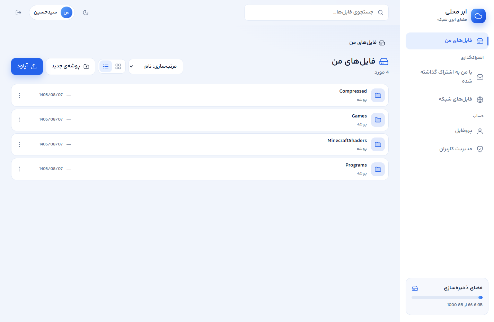
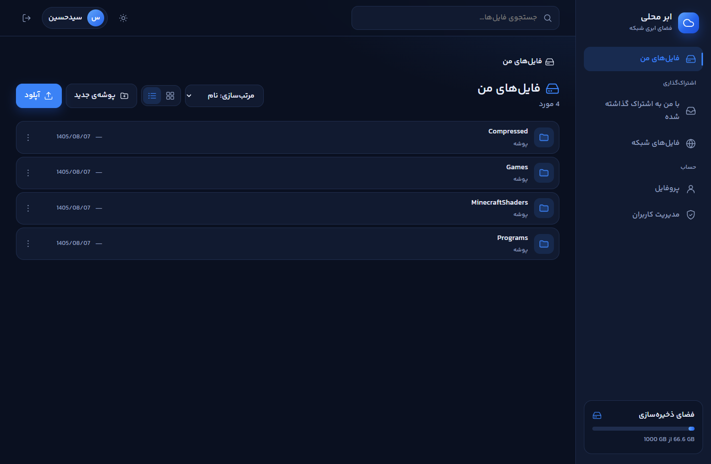
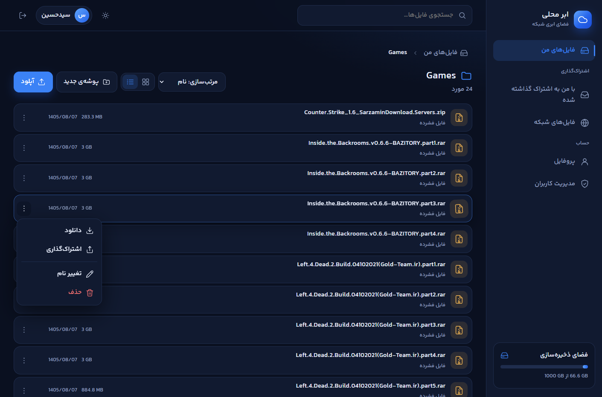
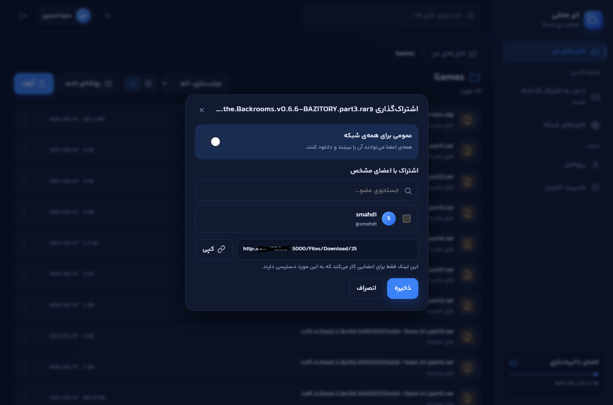
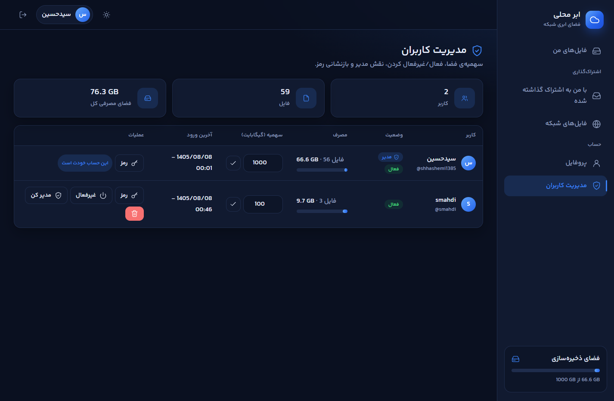
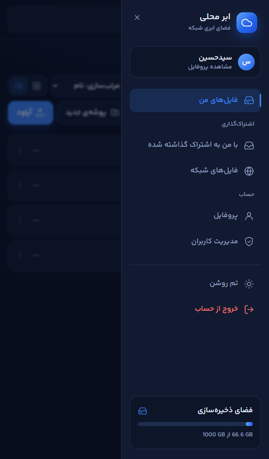

<div align="center">

# ☁️ LanCloud

**Your own private cloud storage on your local network.**
**فضای ابری شخصی شما روی شبکه محلی.**


[English](#-english) · [فارسی](#-فارسی)

</div>

---

# 🇬🇧 English

## Table of Contents

- [About](#about)
- [Features](#features)
- [Screenshots](#screenshots)
- [How It Works](#how-it-works)
- [Prerequisites](#prerequisites)
- [Installation & Running](#installation--running)
- [Configuration](#configuration)
- [Accessing from Other Devices](#accessing-from-other-devices)
- [Firewall Setup](#firewall-setup)
- [Security Notes](#security-notes)
- [Troubleshooting](#troubleshooting)
- [Tech Stack](#tech-stack)
- [License](#license)

## About

**LanCloud** is an ASP.NET Core MVC web application designed to run on a local network and turn one machine (a PC, a home server, a mini-PC, a Raspberry Pi-class device with .NET support, etc.) into a private "cloud drive".

Anyone on the same network, from a computer, phone, tablet, or any other device with a browser, can open the site, sign in, and upload, download, organize, and share files at full local-network speed, without the internet and without third-party services. It is especially handy for moving files between your phone and your PC without cables or messaging apps.

## Features

- 📤 **Fast upload & download** at local network speed
- 📱 **Works on every device** with a web browser (PC, phone, tablet, smart TV...)
- 🔁 **Easy phone ⇄ PC file transfer**
- 👤 **User accounts**: anyone can register; **the first registered account automatically becomes the administrator**
- 📁 **Folders**: create and organize your files in a folder structure
- 📊 **Per-user storage quotas** (default: 100 GB, configurable)
- 🔍 **Search and sorting** for files and folders
- 🔗 **Sharing**: share a file or folder with specific users, or make it public (anyone with the link on your network)
- 🛠️ **Admin panel**: manage users (including their quotas)
- 🎨 **Modern UI with light and dark themes**
- 🌐 **Bilingual interface**: Persian (فارسی) and English
- 🗃️ **Lightweight storage**: SQLite database, no database server needed

## Screenshots

> Screenshots will be added soon.

| Light theme | Dark theme |
| :---: | :---: |
|  |  |

| File manager | Sharing |
| :---: | :---: |
|  |  |

| Admin panel | Mobile view |
| :---: | :---: |
|  |  |

## How It Works

```
┌──────────┐   ┌──────────┐   ┌──────────┐
│  Phone   │   │  Laptop  │   │  Tablet  │
└────┬─────┘   └────┬─────┘   └────┬─────┘
     │   http://<host-ip>:5000     │
     └──────────────┬──────────────┘
                    │  Local network (Wi-Fi / Ethernet)
            ┌───────▼────────┐
            │  Host machine  │
            │   LanCloud     │
            │ (ASP.NET Core) │
            │ SQLite + Files │
            └────────────────┘
```

1. LanCloud runs on one **host machine** and listens on a port (default `5000`).
2. Other devices on the same network open `http://<host-ip>:<port>` in their browser.
3. Users register or sign in. The very first account is the administrator.
4. Files are stored on the host machine's disk, while metadata (users, folders, shares, quotas) is stored in a SQLite database via Entity Framework Core.

## Prerequisites

You need the following on the **host machine** (the one that runs LanCloud):

| Requirement | Why |
| --- | --- |
| **.NET SDK 10** | Needed to build and run the project with `dotnet run` (the SDK already includes the runtime) |
| **.NET Runtime 10 / ASP.NET Core Runtime 10** | Only needed if you run a *published* build instead of using `dotnet run` |
| **Git** | To clone the repository |

### Windows

Using `winget` (Windows 10/11), open **PowerShell** or **Command Prompt**:

```powershell
winget install Microsoft.DotNet.SDK.10
winget install Git.Git
```

Or download the installers manually:
- .NET 10: https://dotnet.microsoft.com/download/dotnet/10.0
- Git: https://git-scm.com/download/win

Verify the installation:

```powershell
dotnet --version
git --version
```

### Linux

Install the .NET 10 SDK using your distribution's package manager. Examples:

```bash
# Ubuntu / Debian
sudo apt update
sudo apt install -y dotnet-sdk-10.0 git

# Fedora
sudo dnf install -y dotnet-sdk-10.0 git

# Arch Linux
sudo pacman -S dotnet-sdk aspnet-runtime git
```

> If the package isn't found on your distribution version, follow the official guide for your distro: https://learn.microsoft.com/dotnet/core/install/linux

For a runtime-only installation (published builds), install `aspnetcore-runtime-10.0` instead of `dotnet-sdk-10.0`.

Verify the installation:

```bash
dotnet --version
git --version
```

## Installation & Running

**1. Clone the repository**

```bash
git clone https://github.com/<your-username>/LanCloud.git
cd LanCloud
```

**2. Go to the project folder** (the folder that contains `LanCloud.csproj` and `appsettings.json`) and run:

```bash
dotnet run
```

That's it! On first run, the SQLite database is created automatically.

**3. Open the site**

On the host machine, open: **http://localhost:5000**

**4. Create the first account**

Register a new account. **The first account you create becomes the administrator**, so do this yourself right after starting the server, before anyone else on the network can.

## Configuration

Settings live in `appsettings.json` in the project folder.

### Port

The default port is **5000**. To change it, edit the Kestrel endpoint:

```json
{
  "Kestrel": {
    "Endpoints": {
      "Http": {
        "Url": "http://0.0.0.0:5000"
      }
    }
  }
}
```

> `0.0.0.0` means "listen on all network interfaces", which is required so that other devices on the network can connect. Change `5000` to any free port you prefer.

### Default storage quota

The default storage quota for each user is **100 GB**. To change it:

```json
{
  "Storage": {
    "DefaultUserQuotaGB": 100
  }
}
```

The administrator can also adjust individual users' quotas from the admin panel.

> After editing `appsettings.json`, restart the application (`Ctrl + C`, then `dotnet run` again).

## Accessing from Other Devices

Other devices on the same local network connect using the **host machine's local IP address** plus the service port:

```
http://<host-ip>:<port>
# Example:
http://192.168.1.10:5000
```

### Finding the host machine's IP address

**Windows**

Open Command Prompt or PowerShell and run:

```powershell
ipconfig
```

Look for **IPv4 Address** under your active adapter (Wi-Fi or Ethernet), e.g. `192.168.1.10`.

**Linux**

```bash
hostname -I
```

or, for more detail:

```bash
ip -4 addr show
```

Look for an address like `192.168.x.x` or `10.x.x.x` on your active interface (e.g. `wlan0`, `eth0`, `enp3s0`).

> 💡 **Tip:** Set a static IP (or a DHCP reservation in your router) for the host machine so the address doesn't change.

## Firewall Setup

To let other devices reach LanCloud, the host's firewall must allow incoming connections on the service port (default `5000`). We recommend **keeping the firewall enabled** and opening only this port, and only for your private network.

### Windows

First, make sure your network is set to **Private**: *Settings → Network & Internet → Wi-Fi/Ethernet → your network → Network profile type → Private*.

#### Option A: Graphical interface (GUI)

1. Press `Win + R`, type `wf.msc`, and press Enter to open **Windows Defender Firewall with Advanced Security**.
2. In the left pane, click **Inbound Rules**, then **New Rule...** in the right pane.
3. Select **Port** → **Next**.
4. Select **TCP**, choose **Specific local ports**, enter `5000` → **Next**.
5. Select **Allow the connection** → **Next**.
6. Check **only Private** (uncheck Domain and Public) → **Next**.
7. Name it `LanCloud` → **Finish**.

#### Option B: Console

Open **Command Prompt** or **PowerShell as Administrator**.

Command Prompt / PowerShell (`netsh`):

```powershell
netsh advfirewall firewall add rule name="LanCloud" dir=in action=allow protocol=TCP localport=5000 profile=private
```

Or PowerShell only:

```powershell
New-NetFirewallRule -DisplayName "LanCloud" -Direction Inbound -Protocol TCP -LocalPort 5000 -Action Allow -Profile Private
```

To remove the rule later:

```powershell
netsh advfirewall firewall delete rule name="LanCloud"
```

> If you changed the port, replace `5000` with your port.

### Linux

#### Option A: UFW (Ubuntu / Debian)

```bash
# Enable the firewall if it isn't already (make sure SSH is allowed first if you use it!)
sudo ufw allow ssh
sudo ufw enable

# Allow LanCloud only from your local subnet (recommended; adjust the subnet to match your network)
sudo ufw allow from 192.168.1.0/24 to any port 5000 proto tcp

# Or allow from anywhere (less strict)
sudo ufw allow 5000/tcp

# Check status
sudo ufw status
```

To remove: `sudo ufw delete allow 5000/tcp`

#### Option B: firewalld (Fedora / RHEL / CentOS)

```bash
sudo firewall-cmd --permanent --add-port=5000/tcp
sudo firewall-cmd --reload
sudo firewall-cmd --list-ports
```

#### Option C: GUI (GUFW)

1. Install it: `sudo apt install gufw` (Ubuntu/Debian).
2. Open **Firewall Configuration** and switch the **Status** toggle to **On**.
3. Click **Rules → +** (Add), go to the **Simple** tab.
4. Set **Direction: In**, **Policy: Allow**, **Protocol: TCP**, **Port: 5000**, and click **Add**.

## Security Notes

- ⚠️ **LanCloud is designed for trusted local networks only.** Do **not** expose it to the public internet (no port forwarding, no public IP/DDNS).
- The default setup uses plain **HTTP** (no encryption). On shared or untrusted Wi-Fi, other people on the network could potentially intercept traffic. Use it on networks you trust, such as your home or office LAN.
- **Register the admin account immediately** after the first launch. The first account created gets full administrative control.
- On Windows, keep the firewall **enabled**, open the port only for the **Private** profile, and avoid using LanCloud on Public networks.
- **Public shares** are accessible to anyone on the network who has the link. Share sensitive files only with specific users.
- Back up the SQLite database and the stored files folder regularly.
- Keep .NET up to date to receive security patches.

## Troubleshooting

| Problem | Possible solution |
| --- | --- |
| Works on the host but not from other devices | Make sure the app listens on `0.0.0.0` (not `localhost`), the firewall allows the port, and both devices are on the same network |
| Phone can't connect on Wi-Fi | Check that the router doesn't have **AP/Client Isolation** enabled, and that you're not on a guest network |
| `Address already in use` | Another program is using the port. Change the port in `appsettings.json` |
| Host's IP address changed | Set a static IP or DHCP reservation for the host |
| `dotnet: command not found` | Install the .NET SDK 10 and reopen your terminal |

## Tech Stack

- **ASP.NET Core MVC** (.NET 10)
- **Entity Framework Core**
- **SQLite**
- HTML, CSS, JavaScript (responsive, light/dark themes)

## License

This project is licensed under the **MIT License**. See the [LICENSE](LICENSE) file for details.

<div align="right">

[⬆ Back to top](#️-lancloud)

</div>

---

<div dir="rtl">

# 🇮🇷 فارسی

## فهرست مطالب

- [درباره پروژه](#درباره-پروژه)
- [امکانات](#امکانات)
- [تصاویر محیط برنامه](#تصاویر-محیط-برنامه)
- [نحوه کارکرد](#نحوه-کارکرد)
- [پیش‌نیازها](#پیشنیازها)
- [نصب و اجرا](#نصب-و-اجرا)
- [تنظیمات](#تنظیمات)
- [دسترسی از سایر دستگاه‌ها](#دسترسی-از-سایر-دستگاهها)
- [تنظیم فایروال](#تنظیم-فایروال)
- [نکات امنیتی](#نکات-امنیتی)
- [عیب‌یابی](#عیبیابی)
- [فناوری‌ها](#فناوریها)
- [مجوز](#مجوز)

## درباره پروژه

**LanCloud** یک وب‌سایت ASP.NET Core MVC است که برای راه‌اندازی روی **شبکه محلی** طراحی شده و یک سیستم (کامپیوتر، سرور خانگی، مینی‌پی‌سی و...) را به یک **فضای ابری خصوصی** تبدیل می‌کند.

هر شخصی که به همان شبکه متصل باشد، چه با کامپیوتر، موبایل، تبلت یا هر دستگاه دیگری که مرورگر دارد، می‌تواند وارد سایت شود و با **سرعت بالای شبکه محلی** فایل‌هایش را آپلود، دانلود، ذخیره، مرتب و به اشتراک بگذارد؛ بدون نیاز به اینترنت و بدون وابستگی به سرویس‌های خارجی. این برنامه مخصوصاً برای انتقال راحت فایل بین **موبایل و کامپیوتر** (و برعکس) بدون کابل و پیام‌رسان کاربردی است.

## امکانات

- 📤 **آپلود و دانلود سریع** با سرعت شبکه محلی
- 📱 **سازگار با همه دستگاه‌ها**: کامپیوتر، موبایل، تبلت و...
- 🔁 **انتقال آسان فایل بین موبایل و سیستم** و برعکس
- 👤 **حساب کاربری**: هر کسی می‌تواند حساب بسازد؛ **اولین حسابِ ساخته‌شده به‌صورت خودکار مدیر وب‌سایت می‌شود**
- 📁 **پوشه‌بندی**: فایل‌ها را در ساختار پوشه‌ای سازماندهی کنید
- 📊 **سهمیه‌بندی کاربران** (پیش‌فرض ۱۰۰ گیگابایت برای هر کاربر، قابل تغییر)
- 🔍 **جستجو و مرتب‌سازی** فایل‌ها و پوشه‌ها
- 🔗 **اشتراک‌گذاری** فایل یا پوشه با اشخاص مشخص، یا به‌صورت **عمومی**
- 🛠️ **بخش مدیریت کاربران** مخصوص مدیر وب‌سایت (شامل مدیریت سهمیه هر کاربر)
- 🎨 **ظاهر زیبا و مدرن** با دو پوسته **تاریک** و **روشن**
- 🌐 **رابط دوزبانه**: فارسی و انگلیسی
- 🗃️ **سبک و ساده**: دیتابیس SQLite و بدون نیاز به نصب سرور دیتابیس

## تصاویر محیط برنامه

> تصاویر به‌زودی اضافه می‌شوند.

| پوسته روشن | پوسته تاریک |
| :---: | :---: |
|  |  |

| مدیریت فایل‌ها | اشتراک‌گذاری |
| :---: | :---: |
|  |  |

| پنل مدیریت | نمای موبایل |
| :---: | :---: |
|  |  |

## نحوه کارکرد

۱. LanCloud روی یک **سیستم میزبان** اجرا می‌شود و روی یک پورت (پیش‌فرض `5000`) منتظر اتصال می‌ماند.
۲. سایر دستگاه‌های همان شبکه، آدرس `http://<آیپی-میزبان>:<پورت>` را در مرورگر خود باز می‌کنند.
۳. کاربران ثبت‌نام می‌کنند یا وارد می‌شوند. **اولین حساب ساخته‌شده، مدیر سایت است.**
۴. فایل‌ها روی دیسک سیستم میزبان ذخیره می‌شوند و اطلاعات کاربران، پوشه‌ها، اشتراک‌گذاری‌ها و سهمیه‌ها در دیتابیس SQLite (از طریق Entity Framework Core) نگهداری می‌شود.

## پیش‌نیازها

روی **سیستم میزبان** (سیستمی که LanCloud را اجرا می‌کند) باید موارد زیر نصب باشد:

| پیش‌نیاز | دلیل |
| --- | --- |
| **.NET SDK 10** | برای ساخت و اجرای پروژه با `dotnet run` (SDK شامل Runtime هم هست) |
| **.NET Runtime 10 / ASP.NET Core Runtime 10** | فقط اگر نسخه **منتشرشده (publish)** را اجرا می‌کنید و از `dotnet run` استفاده نمی‌کنید |
| **Git** | برای دریافت (clone) پروژه از گیت‌هاب |

### ویندوز

با `winget` (ویندوز ۱۰ و ۱۱)، در **PowerShell** یا **Command Prompt**:

```powershell
winget install Microsoft.DotNet.SDK.10
winget install Git.Git
```

یا نصب‌کننده‌ها را به‌صورت دستی دانلود کنید:
- .NET 10: https://dotnet.microsoft.com/download/dotnet/10.0
- Git: https://git-scm.com/download/win

بررسی نصب:

```powershell
dotnet --version
git --version
```

### لینوکس

.NET SDK 10 را با مدیر بسته توزیع خود نصب کنید. چند نمونه:

```bash
# Ubuntu / Debian
sudo apt update
sudo apt install -y dotnet-sdk-10.0 git

# Fedora
sudo dnf install -y dotnet-sdk-10.0 git

# Arch Linux
sudo pacman -S dotnet-sdk aspnet-runtime git
```

> اگر بسته روی نسخه توزیع شما پیدا نشد، راهنمای رسمی مخصوص توزیع خود را دنبال کنید: https://learn.microsoft.com/dotnet/core/install/linux

برای نصب فقط Runtime (اجرای نسخه منتشرشده)، به‌جای `dotnet-sdk-10.0` بسته `aspnetcore-runtime-10.0` را نصب کنید.

بررسی نصب:

```bash
dotnet --version
git --version
```

## نصب و اجرا

**۱. دریافت پروژه از گیت‌هاب**

```bash
git clone https://github.com/<your-username>/LanCloud.git
cd LanCloud
```

**۲. وارد پوشه پروژه شوید** (پوشه‌ای که فایل‌های `LanCloud.csproj` و `appsettings.json` در آن قرار دارند) و دستور زیر را اجرا کنید:

```bash
dotnet run
```

همین! در اولین اجرا، دیتابیس SQLite به‌صورت خودکار ساخته می‌شود.

**۳. باز کردن سایت**

روی خود سیستم میزبان، آدرس **http://localhost:5000** را در مرورگر باز کنید.

**۴. ساخت اولین حساب**

یک حساب جدید بسازید. **اولین حسابی که ساخته شود، مدیر وب‌سایت خواهد بود**؛ بنابراین بلافاصله پس از اجرای سرور، خودتان این کار را انجام دهید، پیش از آن‌که کس دیگری از شبکه این کار را بکند.

## تنظیمات

تنظیمات در فایل `appsettings.json` داخل پوشه پروژه قرار دارد.

### پورت

پورت پیش‌فرض **5000** است. برای تغییر آن، آدرس Kestrel را ویرایش کنید:

```json
{
  "Kestrel": {
    "Endpoints": {
      "Http": {
        "Url": "http://0.0.0.0:5000"
      }
    }
  }
}
```

> آدرس `0.0.0.0` یعنی «روی همه کارت‌های شبکه گوش بده» و برای اتصال سایر دستگاه‌ها ضروری است. عدد `5000` را می‌توانید به هر پورت آزاد دیگری تغییر دهید.

### سهمیه پیش‌فرض کاربران

سهمیه پیش‌فرض هر کاربر **۱۰۰ گیگابایت** است. برای تغییر:

```json
{
  "Storage": {
    "DefaultUserQuotaGB": 100
  }
}
```

مدیر سایت همچنین می‌تواند سهمیه هر کاربر را از بخش مدیریت کاربران تغییر دهد.

> پس از ویرایش `appsettings.json`، برنامه را مجدداً اجرا کنید (`Ctrl + C` و سپس دوباره `dotnet run`).

## دسترسی از سایر دستگاه‌ها

سایر دستگاه‌های متصل به همان شبکه محلی، با **آیپی سیستم میزبان** به‌علاوه **پورت سرویس** وارد می‌شوند:

```
http://<آیپی-میزبان>:<پورت>
# مثال:
http://192.168.1.10:5000
```

### پیدا کردن آیپی سیستم میزبان

**ویندوز**

Command Prompt یا PowerShell را باز کنید و اجرا کنید:

```powershell
ipconfig
```

مقدار **IPv4 Address** مربوط به کارت شبکه فعال (Wi-Fi یا Ethernet) را بردارید، مثلاً `192.168.1.10`.

**لینوکس**

```bash
hostname -I
```

یا برای جزئیات بیشتر:

```bash
ip -4 addr show
```

آدرسی مثل `192.168.x.x` یا `10.x.x.x` را روی کارت شبکه فعال (مثل `wlan0`، `eth0` یا `enp3s0`) پیدا کنید.

> 💡 **نکته:** برای اینکه آدرس میزبان تغییر نکند، یک آیپی ثابت (Static) برایش تنظیم کنید یا در مودم/روتر یک DHCP Reservation تعریف کنید.

## تنظیم فایروال

برای اینکه سایر دستگاه‌ها بتوانند به LanCloud وصل شوند، فایروال سیستم میزبان باید اتصال ورودی روی پورت سرویس (پیش‌فرض `5000`) را مجاز کند. توصیه می‌کنیم **فایروال را روشن نگه دارید** و فقط همین پورت را آن هم فقط برای شبکه خصوصی باز کنید.

### ویندوز

ابتدا مطمئن شوید نوع شبکه شما **Private** است: *Settings ← Network & Internet ← Wi-Fi/Ethernet ← شبکه شما ← Network profile type ← Private*.

#### روش اول: محیط گرافیکی (GUI)

۱. کلیدهای `Win + R` را بزنید، عبارت `wf.msc` را تایپ کنید و Enter بزنید تا **Windows Defender Firewall with Advanced Security** باز شود.
۲. از ستون سمت چپ **Inbound Rules** را انتخاب کنید و در ستون سمت راست روی **New Rule...** کلیک کنید.
۳. گزینه **Port** را انتخاب کنید ← **Next**.
۴. گزینه **TCP** و سپس **Specific local ports** را انتخاب کنید و عدد `5000` را وارد کنید ← **Next**.
۵. گزینه **Allow the connection** را انتخاب کنید ← **Next**.
۶. فقط **Private** را تیک بزنید (تیک Domain و Public را بردارید) ← **Next**.
۷. نام قانون را `LanCloud` بگذارید ← **Finish**.

#### روش دوم: کنسول

**Command Prompt** یا **PowerShell** را با دسترسی **Administrator** باز کنید.

با `netsh`:

```powershell
netsh advfirewall firewall add rule name="LanCloud" dir=in action=allow protocol=TCP localport=5000 profile=private
```

یا فقط در PowerShell:

```powershell
New-NetFirewallRule -DisplayName "LanCloud" -Direction Inbound -Protocol TCP -LocalPort 5000 -Action Allow -Profile Private
```

برای حذف قانون در آینده:

```powershell
netsh advfirewall firewall delete rule name="LanCloud"
```

> اگر پورت را تغییر داده‌اید، عدد `5000` را با پورت خودتان جایگزین کنید.

### لینوکس

#### روش اول: UFW (اوبونتو / دبیان)

```bash
# اگر فایروال روشن نیست، روشنش کنید (اگر از SSH استفاده می‌کنید، اول آن را مجاز کنید!)
sudo ufw allow ssh
sudo ufw enable

# اجازه دسترسی فقط از زیرشبکه محلی (پیشنهادی؛ زیرشبکه را با شبکه خودتان تطبیق دهید)
sudo ufw allow from 192.168.1.0/24 to any port 5000 proto tcp

# یا اجازه از همه‌جا (کم‌محدودیت‌تر)
sudo ufw allow 5000/tcp

# بررسی وضعیت
sudo ufw status
```

برای حذف: `sudo ufw delete allow 5000/tcp`

#### روش دوم: firewalld (فدورا / RHEL / CentOS)

```bash
sudo firewall-cmd --permanent --add-port=5000/tcp
sudo firewall-cmd --reload
sudo firewall-cmd --list-ports
```

#### روش سوم: محیط گرافیکی (GUFW)

۱. نصب: `sudo apt install gufw` (اوبونتو/دبیان).
۲. برنامه **Firewall Configuration** را باز کنید و کلید **Status** را روشن (On) کنید.
۳. روی **Rules** و سپس دکمه **+** کلیک کنید و به تب **Simple** بروید.
۴. **Direction: In**، **Policy: Allow**، **Protocol: TCP** و **Port: 5000** را تنظیم کنید و **Add** بزنید.

## نکات امنیتی

- ⚠️ **LanCloud فقط برای شبکه‌های محلی مورد اعتماد طراحی شده است.** آن را روی اینترنت عمومی **قرار ندهید** (بدون Port Forwarding و بدون آیپی عمومی/DDNS).
- در حالت پیش‌فرض، ارتباط روی **HTTP** و بدون رمزنگاری است. روی Wi-Fi عمومی یا شبکه‌های ناامن، ممکن است دیگران بتوانند ترافیک را مشاهده کنند. فقط روی شبکه‌های مورد اعتماد مثل شبکه خانه یا محل کار استفاده کنید.
- **بلافاصله بعد از اولین اجرا، حساب مدیر را بسازید.** اولین حساب ساخته‌شده، دسترسی کامل مدیریتی دارد.
- در ویندوز ترجیحاً **فایروال را روشن** نگه دارید، پورت را فقط برای پروفایل **Private** باز کنید و از LanCloud روی شبکه‌های **Public** استفاده نکنید.
- **اشتراک‌گذاری عمومی** یعنی هر کسی در شبکه که لینک را داشته باشد می‌تواند به فایل دسترسی پیدا کند. فایل‌های حساس را فقط با اشخاص مشخص به اشتراک بگذارید.
- از دیتابیس SQLite و پوشه فایل‌های ذخیره‌شده به‌طور منظم پشتیبان بگیرید.
- .NET را به‌روز نگه دارید تا وصله‌های امنیتی را دریافت کنید.

## عیب‌یابی

| مشکل | راه‌حل احتمالی |
| --- | --- |
| روی میزبان کار می‌کند ولی از دستگاه‌های دیگر نه | مطمئن شوید برنامه روی `0.0.0.0` (نه `localhost`) گوش می‌دهد، فایروال پورت را مجاز کرده و هر دو دستگاه در یک شبکه‌اند |
| موبایل به Wi-Fi وصل است ولی سایت باز نمی‌شود | بررسی کنید قابلیت **AP/Client Isolation** در روتر خاموش باشد و به شبکه مهمان (Guest) وصل نباشید |
| خطای `Address already in use` | برنامه دیگری از پورت استفاده می‌کند؛ پورت را در `appsettings.json` تغییر دهید |
| آیپی میزبان عوض شده است | برای میزبان آیپی ثابت یا DHCP Reservation تنظیم کنید |
| خطای `dotnet: command not found` | .NET SDK 10 را نصب کنید و ترمینال را دوباره باز کنید |

## فناوری‌ها

- **ASP.NET Core MVC** (‏.NET 10)
- **Entity Framework Core**
- **SQLite**
- HTML، CSS و JavaScript (واکنش‌گرا، با پوسته‌های تاریک و روشن)

## مجوز

این پروژه تحت مجوز **MIT** منتشر شده است. جزئیات در فایل [LICENSE](LICENSE) آمده است.

</div>
